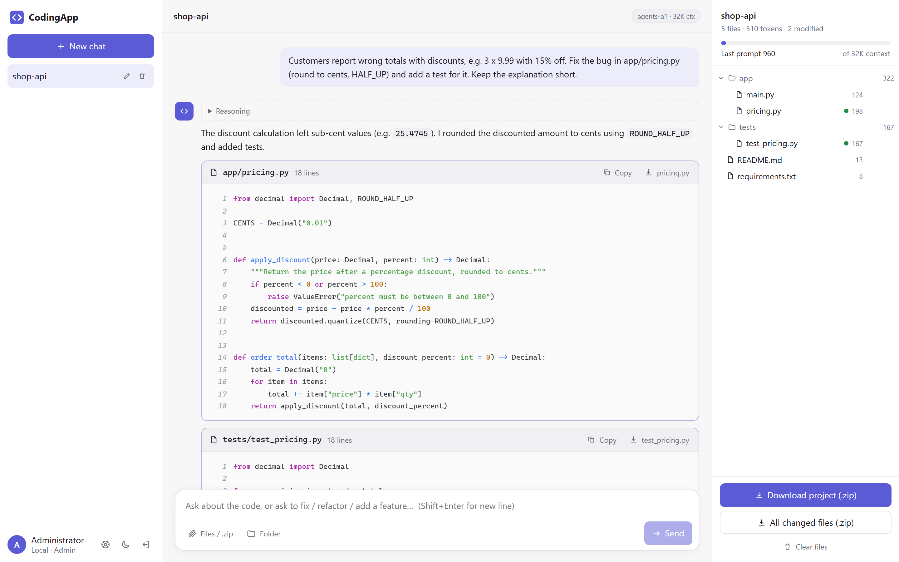
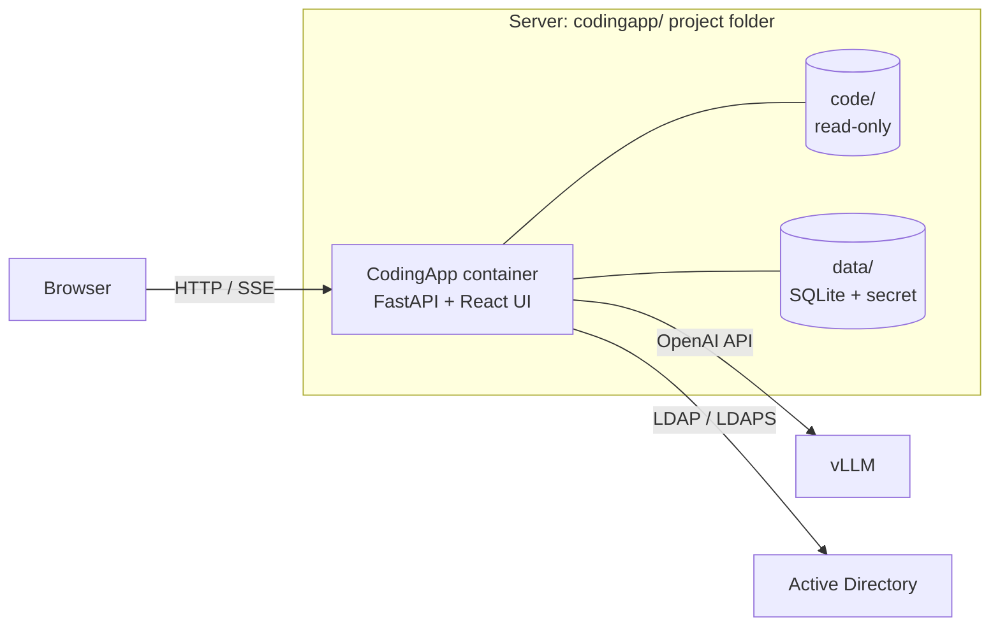

<div align="center">


# CodingApp

**A self-hosted, ChatGPT-style coding assistant for your own LLM, built for air-gapped networks.**

Upload a project, ask questions, get fixes as downloadable files, all on your own vLLM server.


[Features](#features) · [How it works](#how-it-works) · [Quick start](#quick-start) ·
[Documentation](#documentation) · [Development](#local-development)

<br>

<picture>
  <source media="(prefers-color-scheme: dark)" srcset="docs/assets/screenshot-dark.png">
  
</picture>

<sub>A project uploaded as a zip and a bug fixed by the model. Each changed file has Copy / Download buttons, and the project can be downloaded with the fixes applied.</sub>

</div>

---

## Features

| | |
|---|---|
| 📁 **Upload whole projects** | Source files, a folder, or a `.zip` (up to 25 MB). Archives are extracted safely (zip-bomb and path-traversal guards). Binaries, `node_modules`, `.git`, build folders and the like are skipped. |
| 💬 **Chat about your code** | Answers stream in live, with code highlighting. Ask for explanations, reviews, refactors or fixes. |
| 📝 **Files you can use** | Every generated file has **Copy** and **Download** buttons and keeps its real file name. |
| 📦 **Zip downloads** | The full project with all fixes applied (original folder structure), or only the changed files, per answer or for the whole chat. |
| 🧠 **Maximum context use** | Reads `max_model_len` from vLLM and counts tokens exactly via `/tokenize`. It fits the whole project plus chat history into the window. If the project is too big, files are ranked (pinned → mentioned → modified → imported) and the ones left out are listed. |
| 🔁 **Long answers** | Answers continue automatically when they hit the output limit. |
| 🗂️ **Versioned workspace** | Follow-up questions see the **fixed** version of the files. |
| 🔐 **Login** | Built-in admin plus **Active Directory / LDAP** (with or without a service account), configured in the web UI. History is per user. |
| 🎛️ **Admin controls** | Thinking mode On / Off / Model default at runtime, LDAP test tool, user overview. |
| 🛡️ **Air-gapped** | No internet at runtime. The UI loads nothing from external sources. Install and updates are offline packages. |
| ♻️ **Easy updates** | The Docker image is only the runtime. The application code is a folder, so a code update is a ~400 KB package with automatic self-test, backup and rollback. |

## How it works



- **Backend:** FastAPI (Python 3.11) with SQLite. It streams answers as Server-Sent Events.
- **Frontend:** React + Vite + TypeScript, served by the backend. Fully offline.
- **LLM:** any OpenAI-compatible server. Built and tested for **vLLM**.
- **Deployment:**
  - the Docker image `codingapp-runtime:<n>` holds only Python and its libraries;
  - the app is mounted from `code/`;
  - everything else stays in one project folder.

More in [docs/architecture.md](docs/architecture.md).

## Quick start

| Step | Where | Command | Guide |
|---|---|---|---|
| 1. Build | internet-connected machine | `bash scripts/build-release.sh` → `release/codingapp-<ver>-offline.tar.gz` | [BUILD.md](BUILD.md) |
| 2. Install | air-gapped server | `tar -xzf codingapp-<ver>-offline.tar.gz && cd codingapp && sudo bash install.sh` | [DEPLOY.md](DEPLOY.md) |
| 3. Update | air-gapped server | `cd codingapp && sudo ./codingapp.sh update <package>` | [DEPLOY.md](DEPLOY.md#2-updates-always-from-inside-the-project-folder) |

Then open `http://<server>:<port>` and sign in as `admin`.

**Requirements:**
- Build machine: Docker 20.10+ with internet access.
- Server: Linux with Docker 20.10+, and a reachable vLLM (or other OpenAI-compatible) endpoint.

On the server, everything stays in the `codingapp/` project folder:

```
codingapp/
  .env            settings            code/      application (read-only mount)
  data/           database + secret   backups/   backups
  codingapp.sh    manage: update / rollback / status / logs / backup / restore ...
```

## Configuration

The main settings live in `codingapp/.env`:

| Setting | Purpose |
|---|---|
| `APP_PORT` | web port (default `8090`) |
| `ADMIN_PASSWORD` | password of the built-in `admin` |
| `LLM_BASE_URL` | e.g. `http://host.docker.internal:8000/v1` |
| `LLM_API_KEY` | vLLM `--api-key` |
| `LLM_MAX_OUTPUT_TOKENS` | max tokens per answer |

LDAP and the thinking mode are set in the web UI under **Administration**. Full reference:
[docs/configuration.md](docs/configuration.md).

## Documentation

| Document | For |
|---|---|
| [docs/user-guide.md](docs/user-guide.md) | using the app: uploads, chat, downloads |
| [docs/admin-guide.md](docs/admin-guide.md) | LDAP / Active Directory, LLM settings, users |
| [docs/configuration.md](docs/configuration.md) | every `.env` setting |
| [docs/architecture.md](docs/architecture.md) | components, context strategy, runtime vs code |
| [docs/api.md](docs/api.md) | REST API |
| [docs/development.md](docs/development.md) | local development, tests, releases |
| [BUILD.md](BUILD.md) | building the offline packages |
| [DEPLOY.md](DEPLOY.md) | installing, updating and operating on the server |
| [CHANGELOG.md](CHANGELOG.md) | release history |

## Repository layout

```
backend/         FastAPI app (app/) + tests (tests/)
frontend/        React + Vite + TypeScript UI
docker/start.py  runtime entrypoint: checks the mounted code matches the image's libraries
deploy/          shipped to the server: docker-compose.yml, .env.example, install.sh, codingapp.sh
scripts/         build-release.sh / .ps1, selftest.py, make-source-package.py
docs/            documentation
Dockerfile       web (UI build) -> runtime (Python + libs) -> test -> release
VERSION          application version     RUNTIME_VERSION   runtime image version
```

## Local development

```bash
# backend
cd backend
python -m venv .venv && .venv/bin/pip install -r requirements-dev.txt   # Windows: .venv\Scripts\pip
ADMIN_PASSWORD=admin123 LLM_BASE_URL=http://localhost:8000/v1 \
  .venv/bin/python -m uvicorn app.main:app --port 8090 --reload
.venv/bin/python -m pytest -q

# frontend (second terminal)
cd frontend && npm install && npm run dev     # http://localhost:5173, proxies /api to :8090
```

API docs: `http://localhost:8090/api/docs`. See [docs/development.md](docs/development.md).

## License

[MIT](LICENSE) © 2026 Mohammad Kamran Rafi
