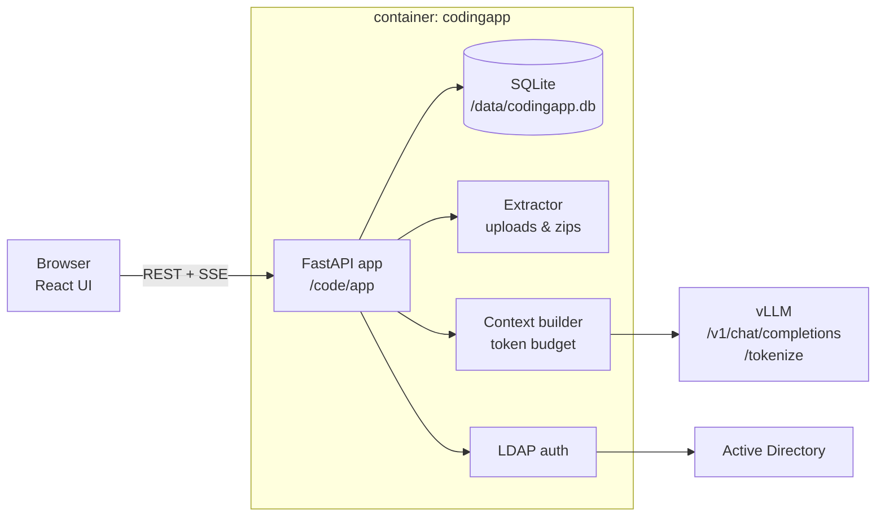

# Architecture

## Components



| Part | Location | Notes |
|---|---|---|
| UI | `frontend/` | React + Vite + TypeScript, built into `code/static`, served by FastAPI. No external assets |
| API | `backend/app/routers` | `auth`, `conversations`, `chat` (streaming), `downloads`, `admin` |
| Services | `backend/app/services` | `extractor`, `context_builder`, `tokens`, `llm_client`, `workspace`, `zip_builder`, `code_parser`, `ldap_auth`, `crypto`, `runtime_settings` |
| Database | `/data/codingapp.db` | SQLite: users, conversations, messages, versioned workspace files, settings |
| Secret | `/data/secret.key` or `SECRET_KEY` | signs sessions and encrypts the LDAP password |

## Runtime image vs code folder

The Docker image `codingapp-runtime:<RUNTIME_VERSION>` contains only Python 3.11, the pinned
libraries and `/opt/runtime/start.py`. The application is a folder on the server:

```
codingapp/code   -> /code  (read-only)
codingapp/data   -> /data  (read-write, uid 10001)
```

At start, `docker/start.py` does the following:
1. Checks that `/code/app` exists.
2. Compares `code/requirements.txt` with the image's requirements and refuses to start on a mismatch, so a code package that needs new libraries can never run on an old image.
3. Sets `APP_VERSION` from `code/VERSION`.
4. Runs uvicorn on port 8090.

The result: a code-only update is a ~400 KB package with no new image. A new image (full package)
is needed only when `requirements.txt` changes, and then `RUNTIME_VERSION` is bumped.

## Uploads

`services/extractor.py` turns files and zips into text files:
- **Safety:** it enforces the size, count and per-file limits, plus a per-entry compression-ratio guard against zip bombs, and rejects absolute paths, `..` and symlinks.
- **Filtering:** it skips VCS, dependency, build and cache folders, binary extensions and binary content.
- **Paths:** it strips a single common root folder (kept as the project name for exports).

## Context strategy (maximum context use)

1. `llm_client.info()` reads `max_model_len` from vLLM `/v1/models` (or uses `LLM_CONTEXT_TOKENS`).
2. Budget = context − `LLM_MAX_OUTPUT_TOKENS` − safety margin.
3. Tokens are counted exactly with vLLM `/tokenize` when available, otherwise estimated.
4. `context_builder.build_messages()` assembles the request:
   - system prompt plus the project file tree;
   - files ranked by `rank_files()`: pinned → mentioned in the message → generated/modified → imported by focus files → others, smallest first;
   - chat history, newest first. Older answers are compressed (code blocks shortened) when space is tight;
   - files that didn't fit are reported to the user.
5. Answers stream as SSE. When `finish_reason == "length"`, the answer is continued automatically
   up to `LLM_AUTO_CONTINUE` times, using vLLM's `continue_final_message` when supported.

## Versioned workspace

Every file is stored as a row with `path`, `version`, `origin` (`upload` / `generated`), the
message that produced it, and a `deleted` flag. `workspace.latest_files()` returns the current
state, optionally as of a given message:
- follow-up questions see the fixed files;
- **Full project** exports apply all changes up to an answer;
- **Changed files** exports contain only `generated` rows.

`code_parser.py` extracts files from answers: fenced code blocks with a path, and deletions.

## Thinking mode

`runtime_settings` stores `default` / `on` / `off`. When set, requests include
`chat_template_kwargs: {"enable_thinking": true|false}`. Reasoning tokens stream separately and
are shown collapsed in the UI.

## Authentication

- Sessions are signed tokens in an HTTP-only cookie (`SESSION_HOURS`, `COOKIE_SECURE`).
- The built-in admin is checked against `.env`.
- LDAP is handled by `services/ldap_auth.py`, which supports three modes: a service account, a direct user bind (UPN or `user_bind_format`), and anonymous search. Optional allowed and admin groups are resolved at every sign-in.

## Deployment model

All state lives in one project folder on the server. `deploy/codingapp.sh` manages:
- install (including migration from 1.0.0's Docker volume);
- updates with offline self-test, backup and automatic rollback;
- backup/restore (online SQLite backup), status and logs.

See [DEPLOY.md](../DEPLOY.md).
